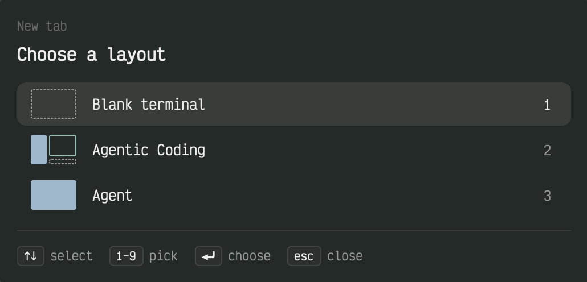

# Saddle

Five keyboard dialogs for starting work. `cmd-t` asks for a tab layout, a harness, a model and an effort, then opens a tab with the agent, its side panes and their split sizes already in place. `cmd-shift-c` jumps straight to the harness pick for the default layout. `cmd-o` finds a project and goes to its space, or opens one with the agent ready. `cmd-r` restarts the agent in the focused tab without disturbing the panes beside it. `cmd-shift-s` picks an SSH host and opens a tab connected to it.

## What you see

All three dialogs share one frame: theme `popover` background, 16px padding, 12px gaps, 13px text. A footer sits below a 1px `border` top line with 12px top padding and 14px gaps. It holds keycaps: an 18px-tall chip with 5px side padding, 4px radius, 1px `border`, `raised` fill and 10.5px `foreground` text, then an 11.5px `muted` label. Errors show as `blocked`-colored text in place of the list. List rows are 8px-radius, `selected` fill when chosen, `hover` fill under the pointer otherwise.

**Launcher** (`cmd-t`, `cmd-shift-c`, `cmd-r`; dialog 520px wide, title "Saddle")

- Top: a 16px-tall breadcrumb at 11.5px of the picks so far (layout › harness › `Model · effort` › tab name), parts in `muted` split by a `dim` "›". Before any pick it reads "New tab" (or "Restart agent") in `dim`.
- Title, 16px semibold `foreground`: "Choose a layout", "Choose a harness", "Choose a model", "What is this tab for?", "Name this tab", "Restart <agent>", "Opening <layout>…", "Restarting…". With several agent panes in a layout, the harness and model titles add ` · <pane>`.
- Rows, 38px tall, 2px apart, 10px side padding, 12px gap:
  - A 44px lead column. Layout rows show a 40×26 miniature of the split tree: 2px gaps, 2px radius; an agent pane is solid `accent`, a command pane has a 1px `ansi6` outline, a shell pane a dashed `muted` outline. Harness rows show a 24px tile with 6px radius in the program's tile color (else `raised`) holding its 15px icon, or the name's first letter in 12px semibold. Usage and "Same setup" rows show a 14px `muted` Nerd Font glyph.
  - The label, truncated. A harness whose program is not installed has a `dim` label and a trailing 11px `dim` "not installed".
  - Model rows with efforts: a segmented control on a `background` strip with 2px padding and 6px radius. Each effort is a 20px-tall, 11px chip with 7px side padding. The current effort is `accent` / `accent_foreground` on the chosen row and `raised` / `foreground` on the others. The rest are `dim` and turn `foreground` on hover.
  - The row number 1–9 at 12px, `foreground` on the chosen row, `muted` elsewhere.
- The layout list always starts with "Blank terminal". The usage step offers "discuss", "review", "debug" and "let me write…".
- The name step: a 36px input with an `accent` 1px border, 8px radius, `background` fill, placeholder "label for this tab…".
- While it opens: a 16px `accent` spinner turning every 900ms beside `muted` "Starting panes". It keeps the previous list's height so the dialog does not jump.
- Footer: `↑↓ select`, `1–9 pick`, `⏎ choose`, `←→ effort` (model step with efforts), `⌫ back` (after the first pick), `⏎ open` (name step), `esc close` (all but while opening).

**Projects** (`cmd-o`; dialog 560px wide)

- A 40px search field with 12px padding, 10px radius, `accent` 1px border and `background` fill. It holds a 15px `muted` search icon and 14px input text, placeholder "Open a project…".
- A list up to 420px tall with a scrollbar. Its groups have 28px headers (11.5px medium `muted`, bottom-aligned): "Recent", "Registered", "zoxide match", "In ~/Projects".
- Rows are 50px tall:
  - A 30px tile with 7px radius. A project already open in a space gets the space's sidebar color with its first letter in 13px semibold white. Otherwise the project's kind icon (nuxt, next, astro, vite, ruby, cargo, go, python, swift, dart, php, deno, node), 15px, tinted by an ANSI theme color on that color at 18% alpha. With no kind it shows a `dim` folder on `raised`.
  - The name, with the matched text in `accent` semibold, then aliases at 11.5px `dim`. The path below it at 11.5px `dim`, `~`-shortened and truncated.
  - On the right, for an open project: the space's agent status and its git branch (11px `dim`, with a branch icon). Otherwise how long ago it was used: `now`, `5m`, `3h`, `2d`, `4mo`, `1y`.
- An empty list says "No project matches" ("Loading…" before the first read). Under fewer than two typed letters it adds "Type two letters to ask zoxide too".
- Footer: `↑↓ select`, `⏎ open`, `esc close`, and "N of M" right-aligned in `dim`.

**SSH** (`cmd-shift-s`; dialog 560px wide)

- The same search field, placeholder "Connect to…".
- A list up to 414px tall with 46px rows:
  - A 30px `raised` tile: a server icon in `accent` for a host from the SSH config, an `ssh` icon in `dim` for a host only used by hand, and a plus in `dim` for what you typed.
  - The first alias in `foreground`, other aliases at 11.5px `dim`. Below: `user@hostname`, "manual", or "connect as typed".
  - The time since last use on the right.
- Footer: `↑↓ select`, `⏎ connect`, `^S edit`, `^X remove`, `esc close`, "N of M".
- The add-host form replaces the list:
  - The field's icon becomes a pen, and the placeholder reads "server-name".
  - A medium heading, "Create SSH config · Alias" (then HostName, User, Port).
  - A 12px monospace preview of the `Host` block on `background` with 10px padding.
  - The last step asks "Add this host to SSH config?" with the input faded to 40%.
  - Footer: `⏎ next`/`add`, `esc cancel`.

## How it behaves

**Agent status** shows only in Projects, for projects open in a space: a 6px dot and word in the theme's status color. They read "working", "needs you" (blocked) and "done". Idle is a 1px `idle` ring with "idle". There is no spinner. The other dialogs show no status.

**Everywhere:** `↑`/`↓` wrap around; `esc` closes; clicking a row picks it. Pressing a dialog's key again closes the open copy and opens a fresh one.

**Launcher**

- `1`–`9` pick a row at once (only without modifiers). `⏎` picks the chosen row and `⌫` steps back one pick, restoring the row you were on. `←`/`→` move the effort on the chosen model row; clicking an effort chip sets it.
- Steps run in order: layout, then for each agent pane a harness and a model. A pane that names its `agent` or `option` in config skips that step, and an agent with no options skips the model step. Then comes the tab name. A layout with `tab_label` uses it. A layout with an agent pane asks "What is this tab for?"; the tab is named after the glyph and word, and "let me write…" opens the name input. A layout with no agent pane goes straight to the name input, where an empty `⏎` takes the layout's name.
- "Blank terminal" closes the dialog and runs plain `tab.new`.
- The new tab opens in the focused space, in the git top level of the focused terminal's folder (else that folder). Each further pane splits right or down from the previous pane (or `split_from`), in the same folder. Each pane takes its `ratio` share of its split, and focus ends on the first pane. If the sizes cannot be written, a warning toast "Saddle: split ratios not applied" appears and the panes keep equal sizes.
- `cmd-shift-c` opens the launcher already past the layout step, on `default_tab_layout`.
- `cmd-r` targets the focused pane if it runs an agent, else the first agent pane in the tab; with none it shows "No agent pane in this tab to restart." The rows are "Same setup" and each configured harness. "Same setup" reruns the exact launch command. A harness goes on to its model step and starts fresh in the agent's current folder, keeping any `env` the old launch set. The pane keeps its place and size, and its neighbours are untouched. The old agent's session is not resumed.
- While opening, keys do nothing; `esc` included.

**Projects**

- Typing filters by name, alias and path. From two letters on, it also asks zoxide, and its best match, if new, appears under "zoxide match".
- Order: registered projects by last use (newest first), then never-used registered ones by name, then the zoxide match, then folders found under `projects_root` that are not registered. A folder counts as a project when it holds `.git` or a marker file, and nested projects inside one are not listed.
- `⏎` or a click records the project as used, recording a folder inside a repo as the repo. If a local space already has a pane in that exact folder, it switches to that space. Otherwise the dialog closes and the launcher opens on the default layout for a new space in that folder: the first tab is named "main" with a branch glyph, and the space takes the project's registry name when it differs from the folder name.
- The list draws from the last open's rows at once, then refreshes in place.

**SSH**

- Typing filters by alias and `user@hostname`. A typed name that is a valid target and not a listed alias appears last as "connect as typed".
- Order: by last use, then by name.
- `⏎` or a click records the use, appends `ssh <target>` to the shell history, and opens a tab named with an SSH glyph and the target, running `ssh -- <target>`. The tab closes when ssh exits. A manual target whose host and user match exactly one config host is merged into that host.
- `ctrl-s` on a config host opens a tab named "ssh config" with `$VISUAL`, else `$EDITOR`, else `nvim` on the SSH config. On any other row it starts the add-host form: Alias, HostName, User and Port, one per `⏎`, prefilled from `user@host` and port 22, each checked as you go. The last `⏎` appends the block to the SSH config, refreshes the list and shows a toast "Added SSH config: <alias>". `esc` leaves the form.
- `ctrl-x` hides a config host (it stays in the config) or deletes a manual one. It does nothing on the typed row.
- Each open syncs with the SSH config: new `Host` entries appear, removed ones vanish, and wildcard patterns are skipped. With no registry yet, it seeds manual targets from `ssh` lines in the shell history.

## Built from

Five mods, all `"place": "none"`, opened only by keys (`keys.json`, `global` section):

| Mod                | Key           | Overlay          | Role                                                                       |
| ------------------ | ------------- | ---------------- | -------------------------------------------------------------------------- |
| `q-saddle-tab`     | `cmd-t`       | dialog, 520 wide | The launcher; props `{direct?, restart?, folder?, label?, name?}`          |
| `q-saddle-agent`   | `cmd-shift-c` | popup, 1×1       | Opens `q-saddle-tab` with `{direct: true}`                                 |
| `q-saddle-restart` | `cmd-r`       | popup, 1×1       | Opens `q-saddle-tab` with `{restart: true}`                                |
| `q-saddle-project` | `cmd-o`       | dialog, 560 wide | Project picker; opens `q-saddle-tab` with `{direct, folder, label, name?}` |
| `q-saddle-ssh`     | `cmd-shift-s` | dialog, 560 wide | SSH picker                                                                 |

`q-saddle-agent` and `q-saddle-restart` render an empty `div()`. In `init` they `closeOverlay(props().overlay)`, then `openOverlay({mod: "q-saddle-tab", props, kind: "dialog", width: 520})`.

**Files**

- Config: `~/.config/herdr-app/data/q-lab/q-saddle/config.json`, read by the launcher, Projects and SSH. Keys:
  - `tab_layouts`, `default_tab_layout`, `agents`, `apply_ratios` (default `true`).
  - `projects_root` (`~/Projects`), `project_markers` (`package.json`, `Gemfile`, `Cargo.toml`, `CLAUDE.md`), `project_registry_file`.
  - `ssh_config_file` (`~/.ssh/config`), `ssh_registry_file`, `ssh_history_file` (`~/.zsh_history`).
  - A layout: `{name, label?, tab_label?, panes}`. A pane: `{name, type: "agent"|"command"|"shell", command? (type command), agent?, option?, env?, direction?: "right"|"down", ratio?: (0,1), split_from?}`; the first pane is the tab root and takes no `direction`/`ratio`/`split_from`.
  - An agent: `{name, label?, kind, command: [...], efforts?, effort_args? (with "{effort}"), extra_args?, options?: [{name, args?, command?, effort?, efforts?}]}`.
  - The launcher validates all of this and lists every error in the dialog.
  - Launch argv: `option.command ?? agent.command`, then `option.args`, then `effort_args` with `{effort}` replaced, then `extra_args`.
- Project registry: `~/.local/state/herdr-projects/registry.json`, `{version: 1, projects: {<path>: {name, aliases?, hidden?, last_used_at, sources}}}`.
- SSH registry: `~/.local/state/herdr-ssh-targets/registry.json`, `{version: 1, targets: {<key>: {source: "config"|"manual", hostname?, user?, aliases?, last_used_at, hidden}}}`.
- Scratch: `data/q-lab/q-saddle/doc-request.json`, holding the JSON-RPC request for `hc connect`.
- `shared()` keys:
  - `q-saddle.overlay`, `q-saddle.project.overlay` and `q-saddle.ssh.overlay` hold the open copy's overlay id.
  - `q-saddle.project.rows` and `q-saddle.ssh.state` are row caches.
  - Projects also reads `space.colors`, written by the shipped `spaces` sidebar.

**`herdr` functions:** `exec`, `run`, `props`, `openOverlay`, `closeOverlay`, `notify`, `theme`, `focused`, `panes`, `terminals`, `spaces`, `knownAgents`, `readTextFile`, `writeTextFile` (with the expected old text), `shared`, `setShared`, `home`, `appHome`. Also `writeFile` from `fs/promises`, for the scratch file, and `readdir`, for one folder's kind. UI: `v_flex`, `h_flex`, `Input`/`InputState`, `v_virtual_list`, `VirtualListScrollHandle`, `Scrollbar` from `gpui-base`; `div`, `svg`, `image` from `gpui-kit`.

**Commands**

- Called as `exec("herdr-app", ["do", <cmd>, <json>])` when the result is needed: `tab.new {name, space, folder, argv?}`, `space.new {name?, tab, folder, argv?}`, `pane.split {direction, pane, argv?}`, `pane.focus {pane}`.
- Called with `run`: `tab.new` (Blank terminal, SSH tabs), `space.select {id}`.
- `herdr-app ls` finds the new tab's pane id.

**Programs:** `herdr-app`, `hc`, `git rev-parse --show-toplevel`, `find`, `zoxide query`, `ssh -G`, `grep`, `sh`, and the configured harnesses.

**Split sizes** (`q-saddle-tab/ratios.js`)

1. `hc connect --json`, given one JSON-RPC line on stdin, runs `doc.get {name: "herdr-app"}`.
2. In that tab's tree, find the lowest node holding both the new pane and the pane it split from.
3. Set the new pane's child to `size.weight = w × ratio` and the other to `w × (1 − ratio)`, where `w` is the other child's old weight.
4. `doc.set {name, value, version}`, retried once on a `conflict` error.

**Restart** (`q-saddle-tab/restart.js`)

1. `hc get <old> --json` gives `argv`, `foreground.argv` and `foreground.cwd`.
2. Build the new launch:
   - Same setup: the old `argv` when it has more than one word, else `sh -c '"$@"; exec "${SHELL:-/bin/sh}"' sh <foreground.argv>`.
   - A new harness: the same handover around any `env K=V` pairs from the old argv plus the new launch, wrapped in a `cd` to the folder.
3. `hc run --bg --no-parent --json --cwd <folder> -- <argv>` starts the new terminal and prints its `address`.
4. `doc.set` rewrites the pane node whose `content.terminal` is the old address to the new one.
5. `hc kill <old>`. If the `doc.set` failed, `hc kill <new>` instead.

**Agent panes:** a pane counts as an agent when `panes()[].program.agent` is true, or when its terminal's `argv` (from `terminals()`) contains a configured agent's `command[0]`.

**Pane argv**

- Command pane: `sh -c '<command>; exec "${SHELL:-/bin/sh}"'`, so a shell takes over when the command ends.
- Shell pane: no argv.
- `env` goes in front as `env K=V …`.
- Every split argv is wrapped as `sh -c 'cd "$1" || exit; shift; [ $# -gt 0 ] || set -- "${SHELL:-/bin/sh}"; exec "$@"' sh <folder> <argv…>`.

**Project sweep**

- One `find <root> ( node_modules -o vendor -o tmp -o log -o coverage -o dist -o build -o .nuxt -o .next ) -prune -o -name .git -prune -print -o ( <markers and kind files> ) -print`, grouped by parent folder.
- Kind comes from the first file that matches, in this order: `nuxt.config.*`, `next.config.*`, `astro.config.*`, `vite.config.*`, `Gemfile`, `Cargo.toml`, `go.mod`, `pyproject.toml`/`requirements.txt`/`setup.py`, `Package.swift`, `pubspec.yaml`, `composer.json`, `deno.json(c)`, `package.json`.
- Kind tints: ruby `ansi1`, node/nuxt `ansi2`, cargo/swift `ansi3`, python/dart `ansi4`, vite/astro/php `ansi5`, go `ansi6`.
- Space tile palette: `ansi6 #22a99a`, `ansi3 #e3814f`, `ansi4 #5b8def`, `ansi5 #8b7cf6`, `ansi2 #3fae6a`, `ansi1 #d9649a`.

**SSH sync:** one `sh` loop runs `ssh -G -F <config> -- <host>` for every literal `Host` group and keeps the first `hostname` and `user`. A shell history line is `: <epoch>:0;ssh <target>`, appended with `sh -c 'printf %s "$2" >> "$1"'`.

**Art**

- From the shipped `workspace-chrome` mod: `mods/workspace-chrome/{spinner,search,folder,git-branch,server,plus,square-pen}.svg`.
- Herdr's own `icons/<kind>.svg` and `icons/ssh.svg`.
- Harness tiles and icons come from `knownAgents()`, matched by `run[0] === command[0]` or `key === kind`.
- Nerd Font glyphs: discuss `U+F442`, review `U+F4AF`, debug `U+EAD8`, let me write `U+F19B9`, Same setup `U+F0453`, main `U+F09D1`, SSH `U+F08A9`.

## Watch out

- `run()` returns null. Use `exec("herdr-app", ["do", cmd, json])` for any command whose ids you need. `tab.new` returns `{space, tab, terminal}` but no pane; look the pane up in `herdr-app ls`, whose plain output is JSON.
- Pass `pane` to every `pane.split`. An implicit split targets whatever is focused.
- `pane.split` has no folder argument, so a new pane starts in the focused terminal's folder; wrap argv in `cd`. It has no env argument either; wrap with `env`.
- `pane.split` execs argv directly and closes the pane when it exits. `tab.new` runs argv inside an interactive shell (`zsh -ic '"$@"; exec "$0" -i'`) that stays afterwards. A leading `exec` therefore closes a `tab.new` tab with its command, which is how the SSH tabs close. In `pane.split`, `exec` is not a program.
- No command sets split sizes. They live in the undocumented `herdr-app` core document as `size.weight`, which can change in any Herdr update. Keep that code in one module behind `apply_ratios`, and treat a failure as a warning. The same goes for restart's `content.terminal` swap.
- `doc.get`/`doc.set` need no `hello`: one JSON-RPC line on `hc connect --json` stdin is enough. Send it through a file (`fs/promises` `writeFile` inside `~/.config/herdr-app`), because a whole document can outgrow one argv entry.
- Restarting a pane means swapping terminals. `hc keep` does not help, and `hc kill` alone closes the pane. Kill only the old address, and only after `doc.set` succeeded. An `hc kill` on the wrong address can end a session; never kill the caller's own `$HC_TERMINAL_ID`.
- `hc ls --json` has no `foreground`, its `cwd` can be stale, and its `agent` field also names file managers such as yazi. Use `hc get --json` and `panes()[].program.agent`.
- Codex and opencode report no status, so `program.agent` is false for them. Also match configured commands in `argv`.
- Herdr reports no agent session ids, so a restart cannot resume a session.
- There is no pane rename. A pane's `label` or `icon` in config is accepted and ignored; only the tab gets a name.
- `mod.open` passes no props, and a mod cannot import another mod folder's files ("resolves outside the application directory"). Hence the two 1×1 popup mods that reopen the launcher with props. The shipped `confirm` mod only runs a `{name, args}` command, so it cannot carry a target pane for restart.
- `mod.open` stacks a new copy per key press. Each dialog keeps its overlay id in `shared()` and closes the previous copy in `init`.
- Closing an overlay hands keyboard focus back. To chain dialogs, close the current one first, then open the next.
- Closing the launcher cancels its tasks. Ignore `esc` while it opens, or you get a half-built tab.
- Mod JS shares the window's thread. A `readdir` walk of `~/Projects` froze the window for seconds; run one `exec("find", …)`. Resolve SSH hosts in one `sh` loop, not one `exec` per host.
- `readTextFile` is slow while a dialog opens (about 0.5s for two files). `shared()` is synchronous, so draw the last rows from the cache first. `setShared` re-renders every mod, so write the cache only when it changed.
- No `.spin()` or other animation inside a `v_virtual_list` row: it made the window unresponsive. Use static marks.
- `herdr-app check` panics (`Option::unwrap()` on `None`) when a `v_virtual_list` has items, even plain text, though the app renders it fine. `q-saddle-project` passes check only while `q-saddle.project.rows` is empty.
- `writeTextFile` can write outside `~/.config/herdr-app` (the registries and the SSH config); `fs/promises` cannot. It replaces the whole file, and reads stop at 1 MiB. Append to shell history with `sh -c 'printf … >>'`.
- Avoid `alt-letter` defaults: option+letter types characters on many Mac keyboards. Avoid ctrl keys that keyboard remappers commonly take over (emacs-style `ctrl-a/b/d/e/f/h/k/n/p`); `ctrl-i` arrives as `tab`.
- The bindings take `cmd-t` and `cmd-r` from their usual uses. "Blank terminal" keeps plain `tab.new` one key away.
- Without `default_tab_layout`, `cmd-shift-c` and a project pick land on row 0, "Blank terminal". That opens a plain tab in the current space, not in the project.
- A project counts as open only when some pane's `cwd` equals its path exactly. A pane in a subfolder does not count.
- The harness list needs a config: with none, the launcher shows "No config at …". `config.example.json` ships two layouts and the agents `claude`, `codex` and `opencode`.
- The setup assumes `hc`, `find`, `git`, `ssh` and `sh` on PATH. `zoxide` is optional, `yazi` is needed only by the example `agentic-coding` layout, and the shell history is zsh's extended format. Every mod runs programs and reads or writes files outside its folder.
- If a long-running Herdr makes every host call slow while an overlay is open (seconds per read), restart Herdr before profiling.

## Done when

- `herdr-app check` passes for `q-saddle-tab`, `q-saddle-agent` and `q-saddle-restart`, and for `q-saddle-project` with an empty `q-saddle.project.rows`.
- `cmd-t` with the example config:
  - It lists "Blank terminal", "Agentic Coding" and "Agent", each with a split miniature.
  - Picking Agentic Coding, claude code, Opus at `high` and "discuss" opens one tab named with the discuss glyph and "discuss".
  - That tab holds `claude --model opus --effort high` on the left, `yazi .` taking 62% on the right, and a shell taking 10% of the right column at the bottom, all in the repo's top folder. Focus is on the agent.
- `⌫` on the model step goes back to the harness step with the earlier row chosen; `1`–`9` pick rows directly.
- A config error (for example a duplicate layout name) shows as red text in the launcher instead of the list.
- With `apply_ratios: false`, the same layout opens with equal splits and no toast.
- `cmd-shift-c` opens on "Choose a harness" with "Agentic Coding" in the breadcrumb.
- `cmd-r` in that tab, with the yazi pane focused:
  - It offers "Same setup" and the agents.
  - "Same setup" restarts claude in the same pane. The yazi and shell panes keep their process and size, and the old terminal is gone from `hc ls`.
  - Picking codex instead starts codex in that pane, in the same folder.
- `cmd-r` in a tab with only shells says "No agent pane in this tab to restart."
- `cmd-o`:
  - It lists registered projects under "Recent", then folders under "In ~/Projects" with kind icons.
  - Typing two letters adds a "zoxide match" row when zoxide knows a folder not listed.
  - Picking an unopened project opens a new space whose first tab is "main", and the project's `last_used_at` updates in the registry.
  - Picking an open one switches to its space, and its row shows that space's status and branch.
- Pressing `cmd-o` twice leaves one Projects dialog.
- `cmd-shift-s`:
  - It lists the `Host` entries of `~/.ssh/config` with `user@hostname`.
  - `⏎` opens a tab named with the SSH glyph and the host, running ssh. The tab closes when ssh exits, and `~/.zsh_history` ends with `: <epoch>:0;ssh <host>`.
  - Typing `me@10.0.0.9` offers "connect as typed".
  - `ctrl-s` on that row walks Alias, HostName (`10.0.0.9`), User (`me`) and Port (`22`), then appends the `Host` block. The host then shows as a config host.
  - `ctrl-x` on a config host hides it, leaves `~/.ssh/config` unchanged, and keeps it hidden after reopening.
